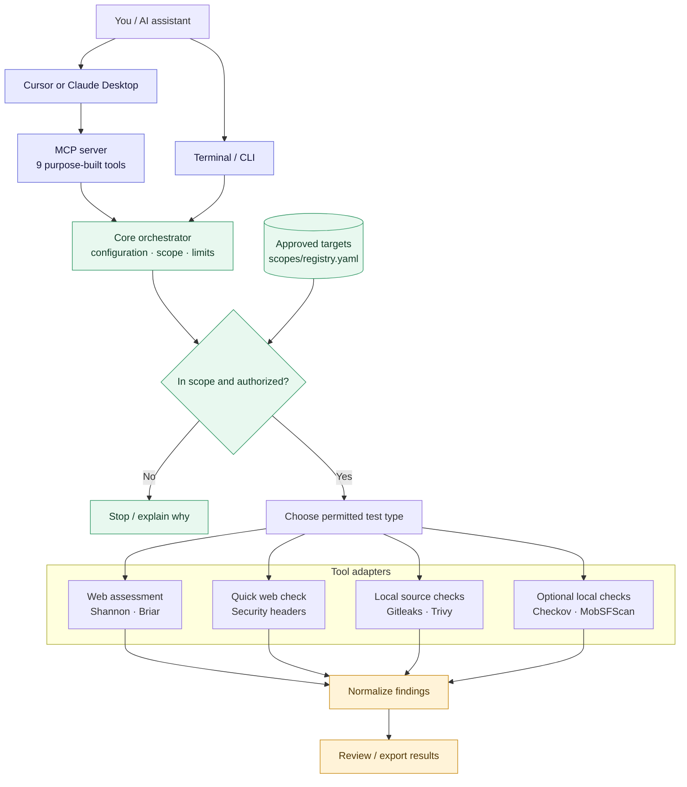
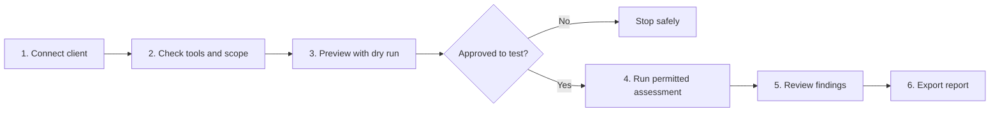
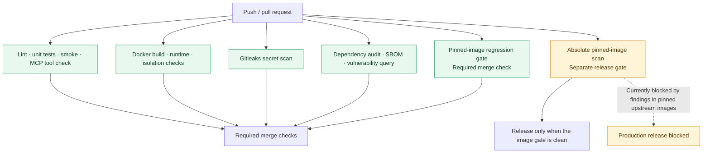

<div align="center">

# 🔐 pen-testing

### Authorized security testing — from your AI assistant or terminal

A small orchestration layer that connects approved security tools, checks scope before testing, and brings results together in one place.

[](https://github.com/eneelkant/pen-testing/actions/workflows/ci.yml)
[](tests/)
[](pyproject.toml)
[](mcp_server/README.md)
[](LICENSE)
[](docs/READINESS_SCORECARD.md)

[Quick start](#-quick-start) · [How it works](#-how-it-works) · [MCP tools](#-what-can-the-mcp-server-do) · [Security status](#-important-security-note)

</div>

> [!WARNING]
> **Alpha software — controlled testing only, not production-ready.** Only test systems you own or have explicit permission to assess. The pinned-container vulnerability gate is still blocking a production release. See the [readiness plan](docs/PRODUCTION_READINESS_PLAN.md).

## ✨ Why use it?

Instead of manually switching between tools, connect this project to an MCP-compatible AI client. The assistant can discover the platform's purpose-built tools, check whether a target is in the approved scope, request a dry run, and help you review findings.

- **One entry point:** a consistent MCP server and CLI for several security tools.
- **Safer by design:** scope checks, dry-run defaults, explicit confirmation for live MCP assessments, and confined paths for local source scans.
- **Clearer results:** findings are normalized and can be reviewed or exported.
- **No magic claims:** a tool is only usable when its adapter and runtime dependencies are available.

## 🧭 How it works

### High-level architecture



### The testing journey



**MCP in plain English:** MCP is the bridge between an AI client and this project's named tools. It does not grant permission to test a website; the target must still pass the project's authorization and safety controls.

## 🚀 Quick start

Requirements: Git and Python 3.10–3.12. Docker and Node.js are additionally needed for Shannon.

```bash
git clone https://github.com/eneelkant/pen-testing.git
cd pen-testing
chmod +x installers/*.sh scripts/*.sh

# Install the minimal MCP profile
PEN_ASSUME_YES=1 bash installers/install.sh mcp
source .venv/bin/activate

# Check your setup and available integrations
python -m core.cli doctor
python -m core.cli capabilities
```

### Connect to Cursor

From the activated virtual environment, run:

```bash
python installers/configure_cursor.py --apply
```

Restart or reload Cursor, then confirm **pen-testing** is connected in Settings → MCP.

For Claude Desktop, use `python installers/configure_claude.py --apply`. See the [AI client setup guide](docs/CLIENT_COMPATIBILITY.md) for details. Client setup scripts create or update local configuration; they do not deploy a remote server.

## 🤖 What can the MCP server do?

| Tool | What it means |
|---|---|
| `platform_status` | See the platform status |
| `check_dependencies` | Check whether required tools are installed |
| `validate_target_scope` | Check whether a target is allowed |
| `list_integrations` | Discover available tools and their health |
| `run_local_diagnostics` | Run non-destructive diagnostics |
| `run_security_assessment` | Preview or run an assessment; dry-run by default |
| `get_assessment_status` | Check assessment progress and status |
| `list_findings` | Review collected findings |
| `export_report` | Export a report draft |

**Example prompt for your connected AI client**

> Check the approved staging target in my scope registry. Verify the platform and scanner health, show me a dry-run plan for the security-headers check, and wait for my approval before any live assessment.

## 🧰 Integrated tools

| Tool | In simple terms |
|---|---|
| [Shannon](https://github.com/KeygraphHQ/shannon) | AI-assisted web security assessment |
| [Briar](https://github.com/Stiimy/briar) | AI-assisted web security assessment |
| Security headers checker | Checks selected HTTP security headers |
| [Gitleaks](https://github.com/gitleaks/gitleaks) | Looks for likely secrets in source code |
| [Trivy](https://github.com/aquasecurity/trivy) | Checks supported files, dependencies and configuration |
| [Checkov](https://github.com/bridgecrewio/checkov) *(optional)* | Checks infrastructure-as-code and configuration |
| [MobSFScan](https://github.com/MobSF/mobsfscan) *(optional)* | Checks Android/iOS **source code** for security patterns |

Checkov and MobSFScan are optional extras and are not installed in the minimal MCP profile:

```bash
pip install -e '.[checkov,mobsfscan]'
python -m core.cli health --tool checkov
python -m core.cli health --tool mobsfscan
```

**Not available yet:** OWASP ZAP, Nuclei, Nmap, Schemathesis, and full MobSF binary/device testing are roadmap items, not runnable integrations. See the [tool matrix](docs/TOOL_MATRIX.md).

## 🧪 CI pipeline

Every pull request runs quality, security and runtime checks. The image regression check looks for newly introduced or unreviewed image findings. A separate absolute image scan is a stricter security gate for release.



- [View CI runs](https://github.com/eneelkant/pen-testing/actions/workflows/ci.yml)
- [Browse unit and runtime tests](tests/)
- [Read the CI workflow](.github/workflows/ci.yml)

## 🔒 Important security note

- Add only approved systems to `scopes/registry.yaml`; a valid URL is not proof of permission.
- Start with a dry run. Live MCP assessments require explicit authorization confirmation; the CLI also defaults to dry-run.
- Do not expose an unauthenticated MCP server to the internet. Local stdio is the documented default; a public ChatGPT-compatible endpoint is **not** deployed by default.
- This project is for controlled testing, not a multi-user production security service. Its pinned upstream container images still have blocking vulnerability findings. Follow the [production readiness plan](docs/PRODUCTION_READINESS_PLAN.md).

## 🗺️ Explore the project

- [Interactive repository diagram](https://gitdiagram.com/eneelkant/pen-testing)
- [Repository text explorer](https://gitingest.com/eneelkant/pen-testing)
- [Architecture details](docs/ARCHITECTURE.md)
- [Installation guide](docs/INSTALLATION.md)
- [MCP server details](mcp_server/README.md)
- [Scope and authorization checks](docs/SECURITY_VALIDATION.md)
- [Isolation design](docs/SCANNER_ISOLATION.md)
- [Roadmap / tool coverage](docs/TOOL_MATRIX.md)
- [Third-party licenses](THIRD_PARTY_NOTICES.md)

## 📄 License

The platform code is licensed under [Apache-2.0](LICENSE). Integrated third-party tools have their own licenses; review [third-party notices](THIRD_PARTY_NOTICES.md) before redistribution.
