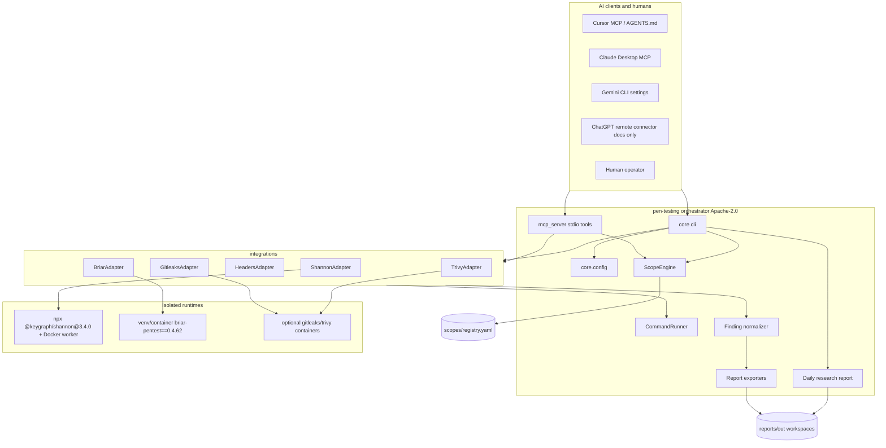

# Architecture

## Goals

Unify authorized white-box (Shannon), black-box (Briar), and complementary scanners behind one scope policy, one finding schema, and Docker-friendly isolation — without vendoring AGPL engines.

## Diagram

## Package layout

| Path | Role |
|---|---|
| `core/` | Config, execution, scope, findings, reporting, diagnostics, retention, SBOM metadata, CLI |
| `integrations/` | Tool adapters implementing `SecurityAdapter` |
| `providers/` | AI provider env detection (no secret values logged) |
| `scopes/` | Authorization registry and examples |
| `reports/` | Templates and generated output (generated gitignored) |
| `scripts/` | Setup/doctor/smoke for bash and PowerShell |
| `docker/` | Worker Dockerfiles |
| `tests/` | Unit/integration tests and local fixtures |
| `docs/` | Architecture, audits, installation, AI setup |

## Adapter interface

All tools implement `integrations.base.SecurityAdapter`:

1. `healthcheck()` — dependency/capability probe, no active scanning
2. `preflight(request)` — mandatory scope enforcement for active categories
3. `run(request)` — execute or dry-run; return `ExecutionResult` with normalized findings

## Finding lifecycle

`candidate → evidence_collected → reproduced → human_reviewed → report_drafted → submitted → resolved`

AI agreement alone must not promote a finding to human-confirmed.

## Isolation strategy

| Tool | Isolation |
|---|---|
| Orchestrator | Own venv / orchestrator container; non-root |
| Shannon | Upstream ephemeral worker via Docker; repo mount read-only (upstream behavior) |
| Briar | Dedicated `.venv-briar` or `docker/briar` image |
| Gitleaks/Trivy | Host binary or official container with read-only source mounts |

Docker socket is **not** mounted into Briar/active-testing workers.

## Typed targets and capability registry

`core/targets.py` defines syntax-validated target descriptors for web/API URLs,
OpenAPI documents, local source paths, hosts/CIDRs and mobile artifacts/device IDs.
These descriptors do **not** grant authorization, resolve DNS, confine filesystem
paths or enable scanner dispatch. Existing `ScopeEngine`, egress checks and local
path confinement remain mandatory before any live operation.

`core/capabilities.py` is the shared descriptive registry for current adapters and
planned candidates. `pen-testing capabilities` lists implemented adapters;
`pen-testing capabilities --include-planned` adds informational roadmap entries.
MCP `list_integrations` returns the same metadata alongside adapter health checks.
A planned capability is not installed or executable simply because it appears in
the registry.

New integrations must preserve the adapter contract and are to be introduced only in
separate PRs with pinned versions, license review, isolated runtime tests, negative
scope tests, normalized findings and updated CI evidence.

## Adding a scanner

1. Create `integrations/<name>/adapter.py` subclassing `SecurityAdapter`
2. Pin version in config / compose
3. Map outputs into `normalize_generic_finding`
4. Add healthcheck + unit tests with mocks/fixtures
5. Update `docs/TOOL_MATRIX.md` and `THIRD_PARTY_NOTICES.md`
